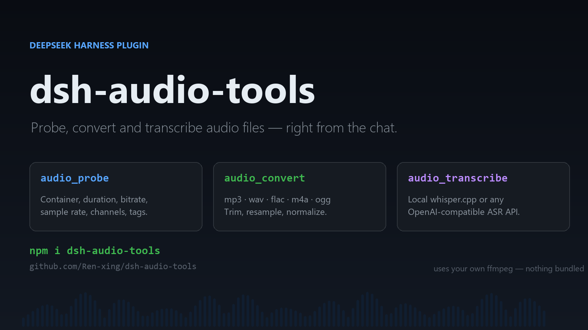
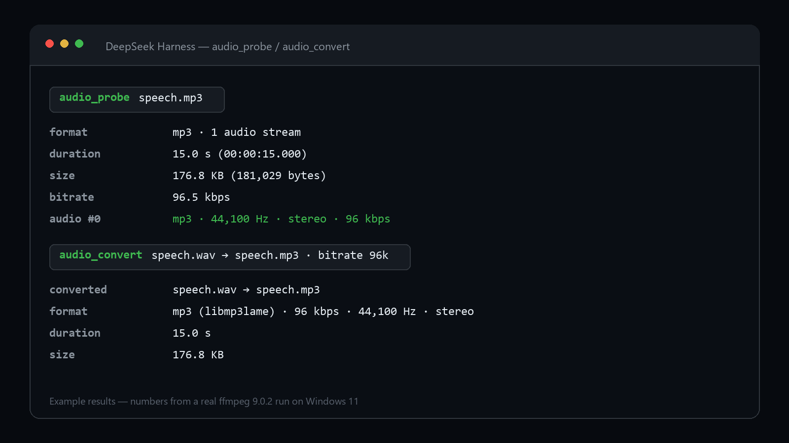
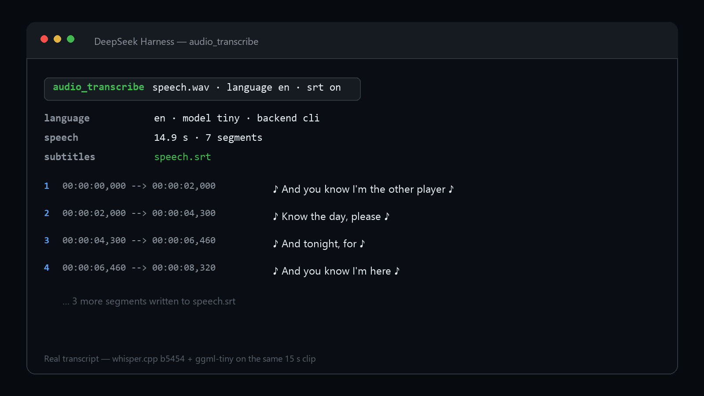

# dsh-audio-tools

English | [中文](README.md)

> Source & issues: <https://github.com/Ren-xing/dsh-audio-tools>



Audio tooling for DeepSeek Harness: inspect audio/video files, transcode or extract a video's audio track, and turn speech into text and subtitles — with **your own ffmpeg**, plus local whisper.cpp or any OpenAI-compatible transcription API.

The plugin itself has **zero npm dependencies**, bundles no binaries, and downloads nothing (the optional model setup script is the only thing that fetches files, and only when you run it).

| Tool | What it does |
| --- | --- |
| `audio_probe` | Container, duration, bitrate, sample rate, channels, tags, and every audio/video stream |
| `audio_convert` | mp3 / wav / flac / m4a / aac / ogg / opus / wma / aiff; extract audio from video; trim; resample; downmix; loudness normalization |
| `audio_transcribe` | Speech to text with timed segments; writes `.txt` / `.srt`; local whisper.cpp or a remote API |

It also ships a skill (`skills/dsh-audio/SKILL.md`) that tells the model which tool to reach for.

## Screenshots





---

## 1. Requirements

- DeepSeek Harness 0.2.x (tested on 0.2.1-rc.2)
- Node.js ≥ 20 (DSH ships its own runtime, nothing to install)
- **ffmpeg + ffprobe** — required; the plugin does not bundle them

Installing ffmpeg on Windows:

```powershell
# winget (adds it to PATH)
winget install --id Gyan.FFmpeg -e

# or scoop
scoop install ffmpeg

# or download manually
# https://www.gyan.dev/ffmpeg/builds/ffmpeg-release-essentials.zip
# then add its bin\ folder to PATH
```

Verify in a new terminal:

```powershell
ffmpeg -version
ffprobe -version
```

> No GPU needed. Local transcription runs on CPU by default; point `whisperPath` at a CUDA build if you have one.

---

## 2. Install the plugin

### Option A: from npm (recommended)

```powershell
& "<DeepSeek Harness>\resources\runtime\cli\bin\dsh.cmd" plugin --profile desktop add dsh-audio-tools
```

The desktop `desktop` profile must be managed by the app's own CLI, not a standalone `dsh`.

Or install a local tarball:

```powershell
& "<DeepSeek Harness>\resources\runtime\cli\bin\dsh.cmd" plugin --profile desktop add "C:\path\to\dsh-audio-tools-0.1.1.tgz"
```

One command does three things: adds the package to the profile's `dependencies` (it runs `pnpm add`), registers it in `dsh.profile.bundles` because it declares `dsh.bundle`, and validates that its `cordis.patch.yml` parses.

Then **quit DeepSeek Harness completely** (including the tray icon) and start it again.

### Option B: copy manually

1. Copy the `dsh-audio-tools` folder into `%USERPROFILE%\.dsh\profiles\desktop\node_modules\dsh-audio-tools`
2. In `%USERPROFILE%\.dsh\profiles\desktop\package.json`, add `"dsh-audio-tools": "0.1.1"` to `dependencies` and `"dsh-audio-tools"` to `dsh.profile.bundles`
3. Restart

### A note on `cordis.yml`

DSH does **not** read its runtime entries from `cordis.yml`. The tree is composed from each package's patch in `dsh.profile.bundles`, then the profile's `cordis.patch.yml`, then home-level overrides. The `cordis.yml` in a profile directory is a generated snapshot — editing it does not install plugins.

Configuration overrides go in `cordis.patch.yml` (see section 3).

### Verify it loaded

After restart, ask in a new chat: “list your audio tools”. You should see `audio_probe`, `audio_convert`, and `audio_transcribe`.

If they do not appear:

- Is `dsh-audio-tools` in `dsh.profile.bundles`?
- Did the app fully exit before restarting?
- Does the startup log mention `dsh-audio-tools` (for example a patch parse error)?

---

## 3. Configuration

Every key is optional. A wrong type or an unknown key produces a warning, never a startup failure.

Put overrides in the profile's **`cordis.patch.yml`**, addressed by id:

```yaml
- id: dsh-audio
  config:
    ffmpegPath: 'D:\tools\ffmpeg\bin\ffmpeg.exe'
    ffprobePath: 'D:\tools\ffmpeg\bin\ffprobe.exe'
    modelDir: 'D:\models\whisper'
    defaultModel: 'small'
    language: 'zh'
    backend: 'cli'
    timeoutMs: 900000
```

| Key | Default | Meaning |
| --- | --- | --- |
| `ffmpegPath` | `null` | Resolved from PATH when unset |
| `ffprobePath` | `null` | Same |
| `whisperPath` | `null` | Falls back to `<plugin>/vendor/whisper/whisper-cli.exe`, then PATH |
| `modelDir` | `~/.dsh/audio-models` | Folder holding `ggml-*.bin` |
| `defaultModel` | `small` | `tiny` / `base` / `small` / `medium` / `large-v3` |
| `language` | `zh` | Default transcription language; `auto` to detect |
| `backend` | `cli` | `cli` (local whisper.cpp) or `api` (OpenAI-compatible endpoint) |
| `apiBaseUrl` | `''` | e.g. `https://api.openai.com/v1` or your own gateway |
| `apiKey` | `''` | Sent as `Authorization: Bearer` |
| `apiModel` | `whisper-1` | Model name for the API backend |
| `outputDir` | `null` | Default output folder; unset means beside the input |
| `timeoutMs` | `600000` | Timeout per ffmpeg/whisper call |
| `threads` | `0` | whisper threads, `0` = auto |

> `apiBaseUrl` may end at `/v1` or be the full `/v1/audio/transcriptions` URL.

---

## 4. Local transcription engine (whisper.cpp)

Only needed for `backend: cli`. The script downloads the Windows whisper.cpp build and a ggml model into the plugin folder and `~/.dsh/audio-models`:

```powershell
cd "$env:USERPROFILE\.dsh\profiles\desktop\node_modules\dsh-audio-tools"
node scripts\setup-whisper.mjs --model small
```

- Models: `tiny` 77 MB, `base` 148 MB, `small` 488 MB, `medium` 1.5 GB, `large-v3` 3.1 GB
- Default mirror is `hf-mirror.com`; pass `--mirror hf` for the official Hugging Face host
- The binary comes from a GitHub release; when GitHub is unreachable it retries through `gh-proxy.com` / `ghproxy.net`
- Existing binaries/models are skipped; `--force` re-downloads
- For Chinese, start at `small`; `medium` if you need more accuracy
- The script prints the matching config block at the end

---

## 5. Usage

Just ask the assistant:

- “What are the duration, bitrate and audio streams of `D:\media\lecture.mp4`?”
- “Convert it to a 128k mp3.”
- “Cut 5 minutes starting at 10:00, and normalize the loudness.”
- “Transcribe this recording into subtitles and save an srt.”
- “What is said in this video? (transcribe, then summarize)”

### Tool reference

**audio_probe**

```json
{ "path": "D:/media/lecture.mp4" }
```

**audio_convert**

| Parameter | Required | Notes |
| --- | --- | --- |
| `input` | ✓ | Source audio or video |
| `format` | | `mp3` `wav` `flac` `m4a` `aac` `ogg` `opus` `wma` `aiff` |
| `output` | | Target path; defaults to the input name with the new extension |
| `bitrate` | | Lossy bitrate such as `"192k"`; rejected for lossless formats |
| `sampleRate` | | 8000–192000 |
| `channels` | | `1` or `2` |
| `start` / `duration` | | Seconds, `"mm:ss"` or `"hh:mm:ss"` |
| `normalize` | | `true` applies EBU R128 loudness normalization (-16 LUFS) |
| `audioStream` | | Which audio stream when there are several (0-based) |
| `overwrite` | | Defaults to `false`; refuses to replace an existing output |

**audio_transcribe**

| Parameter | Required | Notes |
| --- | --- | --- |
| `input` | ✓ | Audio or video |
| `language` | | `zh` / `en` / … or `auto` |
| `model` | | Overrides `defaultModel` (cli backend) |
| `backend` | | Overrides `backend` (cli / api) |
| `prompt` | | Initial prompt with names or terms (cli backend) |
| `srt` | | `true` writes a matching `.srt` beside the input |
| `output` | | Writes the text; an `.srt` extension writes subtitles |

---

## 6. Safety and boundaries

- **No bundled ffmpeg** — when it is missing, the error includes install instructions; nothing is downloaded silently
- **Never rewrites the input in place** — same-path output requires `overwrite: true` and goes through a temp file plus an atomic replace
- **No shell** — every external command is spawned with an argument array (`spawn` + `argv`), no string concatenation or globbing
- **Bounded runtime** — 10 minutes by default; on timeout the whole process tree is killed (`taskkill /T /F` on Windows)
- **API backend** — 24 MB per file; keys stay in local config
- **Transcript output** — written where the caller asks; parent folders are created

---

## 7. Troubleshooting

**`ffmpeg was not found`** — install ffmpeg and restart; if it is not on PATH, set `ffmpegPath` / `ffprobePath`.

**`whisper-cli was not found`** — run the setup script in section 4, or point `whisperPath` at your own `whisper-cli.exe`.

**`whisper model ... is missing`** — the model did not finish downloading or `modelDir` is wrong; re-run the script and check the printed path.

**Poor recognition in Chinese** — use `small` / `medium`, set `language: 'zh'`, and pass domain terms through `prompt`.

**Transcription feels slow** — an hour of audio with `small` takes tens of minutes on CPU. Pre-compress with `audio_convert` to 16 kHz mono, or start with `tiny` / `base`.

**API returns 401 / 413** — 401 means check `apiKey`; 413 means the file exceeds 24 MB, so trim it first or use the local backend.

**Tools do not appear** — confirm `dsh-audio-tools` is in `dsh.profile.bundles`, fully quit the app, and check the startup log.

**Non-ASCII (Chinese) paths**

The Windows build of whisper.cpp opens model and audio files through narrow Windows APIs and crashes with `0xC0000409` on paths containing non-ASCII characters. The plugin handles this: transcription picks an ASCII temp directory first and **hard-links** the model into it (nearly free on the same volume, falls back to a copy across volumes). If even `TEMP` contains non-ASCII characters and no ASCII temp directory is usable, the tool fails with an actionable message instead of a crash — change `TEMP`, or use `backend: "api"`.

---

## 8. Development and testing

```
dsh-audio-tools/
  lib/
    index.js              plugin entry (name / inject / apply)
    config.js             config validation and defaults
    runtime.js            lazy resolution of ffmpeg / whisper / models
    media.js              ffprobe wrapper, format table
    exec.js               child processes (timeout + process-tree kill)
    format.js             time and size formatting
    tools/{probe,convert,transcribe}.js
    transcribe/{whisper-cli,api}.js
  skills/dsh-audio/SKILL.md
  scripts/setup-whisper.mjs
  test/*.test.js
  cordis.patch.yml
```

```powershell
# unit tests (no ffmpeg needed)
node test/format.test.js
node test/config.test.js
node test/plugin.test.js
node test/whisper-parse.test.js

# end-to-end tests (need ffmpeg/ffprobe)
$env:DSH_AUDIO_FFMPEG  = "C:\ffmpeg\bin\ffmpeg.exe"
$env:DSH_AUDIO_FFPROBE = "C:\ffmpeg\bin\ffprobe.exe"
node test/integration.test.js

# with a local whisper install the transcription path is tested too
$env:DSH_AUDIO_WHISPER    = "C:\...\vendor\whisper\whisper-cli.exe"
$env:DSH_AUDIO_MODELS     = "C:\Users\<you>\.dsh\audio-models"
$env:DSH_AUDIO_SPEECH_WAV = "C:\path\to\speech.wav"
node test/integration.test.js
```

> In restricted sandboxes `node --test` can fail with `EPERM` because it spawns child processes; run the files one by one as above. `npm test` works normally in a regular terminal.

---

## 9. Uninstall

```powershell
& $dsh plugin --profile desktop remove dsh-audio-tools
```

Then delete `"dsh-audio-tools"` from `dsh.profile.bundles` and restart. The model folder (`~/.dsh/audio-models`) is yours to keep or delete.

---

## License

MIT
