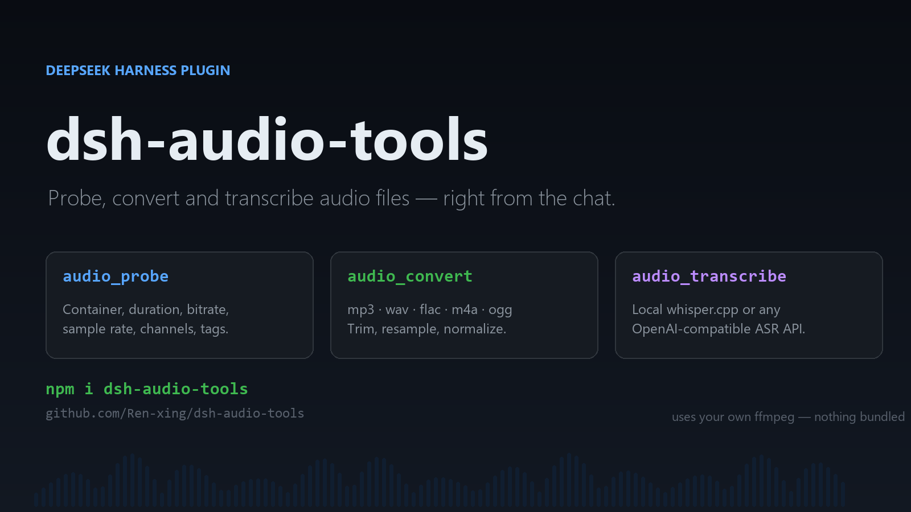
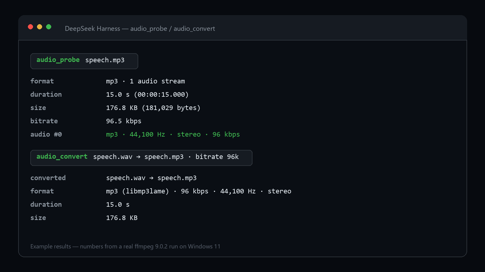
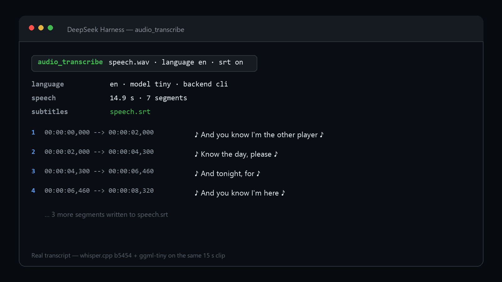

# dsh-audio-tools

[English](README.en.md) | 中文

<!-- repo-link -->
> 源码与问题反馈：https://github.com/Ren-xing/dsh-audio-tools



DeepSeek Harness 音频插件：用本机 ffmpeg 查看音频/视频信息、转换格式、从视频里抽音轨，用 whisper.cpp 或任意 OpenAI 兼容接口把语音转成文字和字幕。

插件本身**零 npm 依赖**，不打包 ffmpeg，也不下载任何东西（模型安装脚本除外，需要时手动跑）。

| 工具 | 作用 |
| --- | --- |
| `audio_probe` | 读容器、时长、码率、采样率、声道、标签、音视频流 |
| `audio_convert` | 转 mp3/wav/flac/m4a/aac/ogg/opus/wma/aiff；视频抽音轨；裁剪；重采样；单声道；响度归一化 |
| `audio_transcribe` | 语音转文字，返回全文 + 带时间轴分段，可写 `.txt` / `.srt` |

同时注册一个同名 skill（`skills/dsh-audio/SKILL.md`），告诉模型什么时候该用哪个工具。





---

## 1. 运行要求

- DeepSeek Harness 0.2.x（实测 0.2.1-rc.2）
- Node.js ≥ 20（DSH 自带 24，无需另装）
- **ffmpeg + ffprobe**（必须，插件不自带）

Windows 安装 ffmpeg 的几种方式：

```powershell
# 方式一：winget（推荐，会自动进 PATH）
winget install --id Gyan.FFmpeg -e

# 方式二：scoop
scoop install ffmpeg

# 方式三：手动下载
# https://www.gyan.dev/ffmpeg/builds/ffmpeg-release-essentials.zip
# 解压后把其中的 bin\ 目录加入系统 PATH
```

验证（新开一个终端）：

```powershell
ffmpeg -version
ffprobe -version
```

> 不需要 GPU。本地转写默认用 CPU；想用 CUDA 版 whisper 可以自己替换 `whisperPath`。

---

## 2. 安装插件

### 方式 A：命令行安装（推荐）

用**应用自带的 CLI**（`desktop` profile 只能由桌面端 CLI 管理，普通 `dsh` 不行）：

```powershell
$dsh = "C:\Users\<你>\Desktop\杂七杂八\deepseek\resources\runtime\cli\bin\dsh.cmd"
# 或默认安装位置： "$env:LOCALAPPDATA\Programs\DeepSeek Harness\resources\runtime\cli\bin\dsh.cmd"

& $dsh plugin --profile desktop add "C:\path\to\dsh-audio-tools-0.1.0.tgz"
```

一条命令做三件事：把包装进 profile 的 `dependencies`（内部是 `pnpm add`）、因为它声明了 `dsh.bundle` 而自动写进 `dsh.profile.bundles`、并校验它的 `cordis.patch.yml` 能被解析。

然后**完全退出 DeepSeek Harness（托盘图标也要退）再启动**。启动时它的 `cordis.patch.yml` 会把 `dsh-audio` 条目插进运行配置。

> 也可以从插件市场/插件管理界面安装本地 tgz，效果一样。

### 方式 B：手动复制（不装依赖）

1. 把整个 `dsh-audio-tools` 文件夹复制到 `%USERPROFILE%\.dsh\profiles\desktop\node_modules\dsh-audio-tools`
2. 编辑 `%USERPROFILE%\.dsh\profiles\desktop\package.json`：`dependencies` 里加 `"dsh-audio-tools": "0.1.0"`，`dsh.profile.bundles` 里加 `"dsh-audio-tools"`
3. 重启

### 关于 `cordis.yml`

DSH 的运行条目**不是**从 `cordis.yml` 读的，而是 `dsh.profile.bundles` 里每个包的 patch 依次叠加（再叠加 profile 的 `cordis.patch.yml` 和 home 级覆盖）。profile 目录里的 `cordis.yml` 是应用生成/重置的快照，**不要靠改它来装插件**。

配置覆盖则写在 `cordis.patch.yml` 里（见第 3 节），这是官方支持的覆盖层。

### 确认装好了

重启后新建对话问一句「列出你有哪些 audio 工具」，应该能看到 `audio_probe` / `audio_convert` / `audio_transcribe`。

如果没出现，检查：

- `%USERPROFILE%\.dsh\profiles\desktop\package.json` 的 `dsh.profile.bundles` 里有没有 `dsh-audio-tools`
- 重启前有没有完全退出应用（托盘也要退）
- 启动日志里 `dsh-audio-tools` 有没有报错（例如 patch 解析失败）

---

## 3. 配置

所有键都是可选的，写错类型或写错键名只会告警，不会让 profile 起不来。

配置写在 profile 的 **`cordis.patch.yml`**（用户覆盖层），用 id 定位：

```yaml
- id: dsh-audio
  config:
    ffmpegPath: 'D:\tools\ffmpeg\bin\ffmpeg.exe'
    ffprobePath: 'D:\tools\ffmpeg\bin\ffprobe.exe'
    modelDir: 'D:\models\whisper'
    defaultModel: 'small'
    language: 'zh'
    backend: 'cli'
    timeoutMs: 900000
```

| 键 | 默认 | 说明 |
| --- | --- | --- |
| `ffmpegPath` | `null` | 不填就在 PATH 里找 |
| `ffprobePath` | `null` | 同上 |
| `whisperPath` | `null` | 不填就找 `<插件>/vendor/whisper/whisper-cli.exe`，再找 PATH |
| `modelDir` | `~/.dsh/audio-models` | 放 `ggml-*.bin` 的目录 |
| `defaultModel` | `small` | `tiny` / `base` / `small` / `medium` / `large-v3` |
| `language` | `zh` | 默认转写语言，写 `auto` 自动检测 |
| `backend` | `cli` | `cli`（本地 whisper.cpp）或 `api`（OpenAI 兼容接口） |
| `apiBaseUrl` | `''` | 例如 `https://api.openai.com/v1` 或自建网关 |
| `apiKey` | `''` | 走 `Authorization: Bearer` |
| `apiModel` | `whisper-1` | API 后端的模型名 |
| `outputDir` | `null` | 转换输出的默认目录；不填则输出在输入旁边 |
| `timeoutMs` | `600000` | 单次 ffmpeg/whisper 调用超时 |
| `threads` | `0` | whisper 线程数，0 = 自动 |

> `apiBaseUrl` 支持填到 `/v1` 或直接填完整的 `/v1/audio/transcriptions`。

---

## 4. 安装本地转写引擎（whisper.cpp）

只有用 `backend: cli` 才需要。脚本会下载 whisper.cpp 的 Windows 二进制和 ggml 模型，自动放到插件目录和 `~/.dsh/audio-models`：

```powershell
cd "$env:USERPROFILE\.dsh\profiles\desktop\node_modules\dsh-audio-tools"
node scripts\setup-whisper.mjs --model small
```

- 默认走 `hf-mirror.com`（国内可访问）；要官方源加 `--mirror hf`
- 二进制从 GitHub Release 拉，直连不通时会自动重试 `gh-proxy.com` / `ghproxy.net` 镜像
- 模型大小：`tiny` 77 MB、`base` 148 MB、`small` 488 MB、`medium` 1.5 GB、`large-v3` 3.1 GB
- 中文日常使用 `small` 起步；追求准确率用 `medium`
- 已存在的二进制/模型会跳过，加 `--force` 重新下载
- 脚本结束会打印这段配置，路径和默认值一致时不用改：

```yaml
- id: dsh-audio
  config:
    whisperPath: 'C:\...\vendor\whisper\whisper-cli.exe'
    modelDir: 'C:\Users\<你>\.dsh\audio-models'
    defaultModel: 'small'
```

---

## 5. 怎么用

直接对助手说就行，例如：

- 「看看 `D:\media\lecture.mp4` 的时长、码率和音轨信息」
- 「把它转成 128k 的 mp3」
- 「从 10:00 开始截 5 分钟，音量顺便拉齐」
- 「把这段录音转成带时间轴的字幕，存成 srt」
- 「这个视频里讲了什么？（转写后总结）」

### 工具参数速查

**audio_probe**

```json
{ "path": "D:/media/lecture.mp4" }
```

**audio_convert**

| 参数 | 必填 | 说明 |
| --- | --- | --- |
| `input` | ✓ | 源文件（音频或视频） |
| `format` | | `mp3` `wav` `flac` `m4a` `aac` `ogg` `opus` `wma` `aiff` |
| `output` | | 目标路径；不填则输入同名换扩展名 |
| `bitrate` | | 有损格式的码率，如 `"192k"`、`192000`；无损格式传了会报错 |
| `sampleRate` | | 8000–192000 |
| `channels` | | `1` 或 `2` |
| `start` / `duration` | | 秒、"mm:ss" 或 "hh:mm:ss" |
| `normalize` | | `true` 时做 EBU R128 响度归一化（-16 LUFS） |
| `audioStream` | | 多音轨时指定第几条（从 0 开始） |
| `overwrite` | | 默认 `false`，已存在就报错 |

**audio_transcribe**

| 参数 | 必填 | 说明 |
| --- | --- | --- |
| `input` | ✓ | 音频或视频 |
| `language` | | `zh` / `en` / … 或 `auto` |
| `model` | | 覆盖 `defaultModel`（仅 cli） |
| `backend` | | 覆盖 `backend`（cli / api） |
| `prompt` | | 给识别加提示词（人名、术语，仅 cli） |
| `srt` | | `true` 时在输入旁边写同名 `.srt` |
| `output` | | 写文本；`.srt` 结尾则写字幕 |

---

## 6. 边界与安全

- **不打包 ffmpeg**：缺 ffmpeg 时报错并附安装命令，不会偷偷下载
- **不原地改输入**：输出与输入同路径时必须显式 `overwrite: true`，且先写临时文件再原子替换
- **不拼 shell**：所有外部命令用参数数组直传（`spawn` + `argv`），没有字符串拼接和通配符展开
- **超时可控**：默认 10 分钟，到点连同子进程一起杀掉（Windows 用 `taskkill /T /F`）
- **API 后端**：单文件上限 24 MB；密钥只存在本地配置里
- **转写输出**：写到调用方指定路径，父目录自动创建

---

## 7. 常见问题

**`ffmpeg was not found`**
装 ffmpeg 并重启；装在非 PATH 位置就配 `ffmpegPath` / `ffprobePath`。

**`whisper-cli was not found`**
跑第 4 节的安装脚本，或把 `whisperPath` 指到自己的 `whisper-cli.exe`。

**`whisper model ... is missing`**
模型没下全或 `modelDir` 不对；重新跑脚本，注意脚本输出的路径。

**中文识别错得多**
换 `small` / `medium`；`language: 'zh'` 明确指定；专有名词用 `prompt` 提示。

**转写很慢**
CPU 上 1 小时音频用 `small` 大约要几十分钟。可先 `audio_convert` 压成 16 kHz 单声道 mp3 再转写；或换 `tiny`/`base` 先粗转。

**走 API 报 401 / 413**
401 检查 `apiKey`；413 是超过 24 MB，先裁剪或换本地后端。

**装了插件但工具没出现**
确认 `dsh.profile.bundles` 里有 `dsh-audio-tools`；完全退出应用再启动；看启动日志里有没有 `dsh-audio-tools` 的告警。

**中文路径 / 用户名含中文**

whisper.cpp 的 Windows 版本不认非 ASCII 路径，会以 `0xC0000409` 崩溃。插件已经处理：转写时会先挑一个纯英文临时目录，把模型**硬链接**（同盘几乎零开销，跨盘自动改成复制）进去再调用。如果连 `TEMP` 都是中文路径、且没有可用的英文临时目录，工具会直接报一条能看懂的错，提示你改 `TEMP` 或改用 `backend: "api"`。

---

## 8. 开发与测试

```
dsh-audio-tools/
  lib/
    index.js              插件入口（name / inject / apply）
    config.js             配置校验与默认值
    runtime.js            懒解析 ffmpeg / whisper / 模型路径
    media.js              ffprobe 封装、格式表
    exec.js               子进程执行（超时 + 进程树终止）
    format.js             时间/大小格式化
    tools/{probe,convert,transcribe}.js
    transcribe/{whisper-cli,api}.js
  skills/dsh-audio/SKILL.md
  scripts/setup-whisper.mjs
  test/*.test.js
  cordis.patch.yml
```

```powershell
# 单元测试（不需要 ffmpeg）
node test/format.test.js
node test/config.test.js
node test/plugin.test.js

# 端到端测试（需要 ffmpeg/ffprobe）
$env:DSH_AUDIO_FFMPEG  = "C:\ffmpeg\bin\ffmpeg.exe"
$env:DSH_AUDIO_FFPROBE = "C:\ffmpeg\bin\ffprobe.exe"
node test/integration.test.js

# 加上本地 whisper 后还会测转写
$env:DSH_AUDIO_WHISPER   = "C:\...\vendor\whisper\whisper-cli.exe"
$env:DSH_AUDIO_MODELS    = "C:\Users\<你>\.dsh\audio-models"
$env:DSH_AUDIO_SPEECH_WAV = "C:\path\to\speech.wav"
node test/integration.test.js
```

> 在受限沙箱里 `node --test` 会因为无法创建子进程而 `EPERM`，按上面的方式逐个文件跑即可；普通终端里 `npm test` 正常。

---

## 9. 卸载

```powershell
& $dsh plugin --profile desktop remove dsh-audio-tools
```

再从 `dsh.profile.bundles` 里删掉 `"dsh-audio-tools"`，重启。模型目录（`~/.dsh/audio-models`）想清就自己删。

---

## License

MIT
